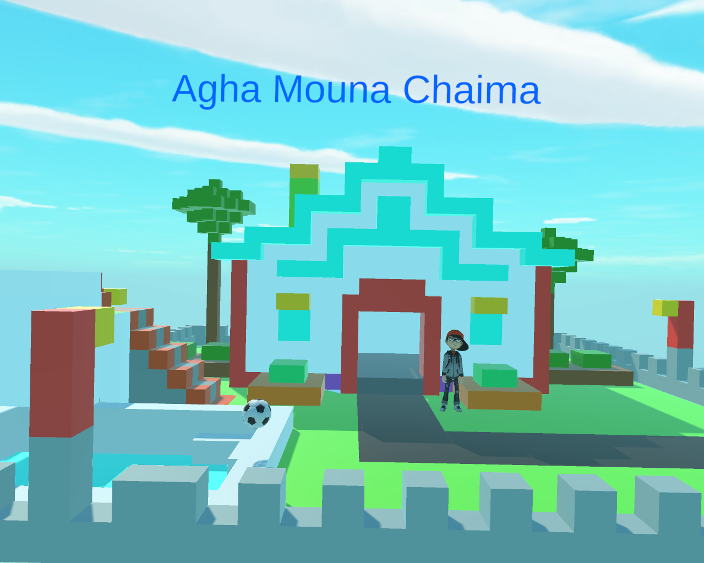

# VR Classroom Prototype

## Overview
This project presents a Virtual Reality classroom prototype built using Unity 3D.
It allows users to explore and interact with a 3D classroom environment using VR.
The project is intended as a research prototype and a foundation for immersive VR education or VR interaction systems.

## My Role
**Lead Developer** — designed and implemented all AI integration (NLP, voice, gesture), NPC behavior, API integration, and interaction systems.

## Demo Video

https://github.com/user-attachments/assets/100e4ca7-66dc-4145-8a49-e4dde75b08de

## Screenshots

## Technologies
- Unity 3D (2021.3 LTS)
- C#
- XR Plugin Management (for VR headset support)
- VR headset (Oculus, HTC Vive, or compatible)

## Features
- **AI-powered NPC teacher** with NLP-based voice interaction
- **Gesture-based controls** using hand tracking
- **REST API integration** for real-time AI services
- **Cross-platform deployment:** PC, mobile, and Meta Quest
- Interactive 3D classroom environment
- Object interaction (picking, examining)

## Research Context
This project is related to VR education, human-computer interaction (HCI), and immersive learning environments.
It can be extended for multi-user VR classrooms, AI-driven interactions, or educational simulations.

## Credits
- Character model and animations: [Mixamo](https://www.mixamo.com) (free)
- Some 3D environment assets: Unity Asset Store (free/educational)
- All code, AI integration (NLP, voice, gesture), NPC behavior, API integration, and gameplay systems: developed by me
  
## Status
Ongoing research prototype.
